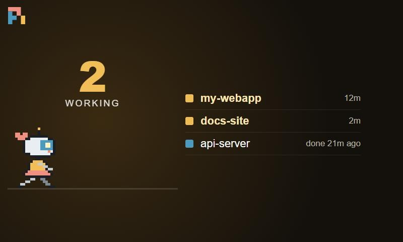
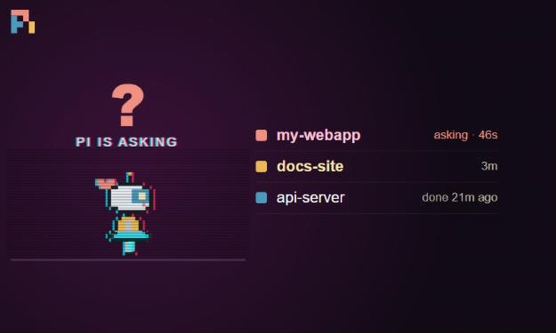
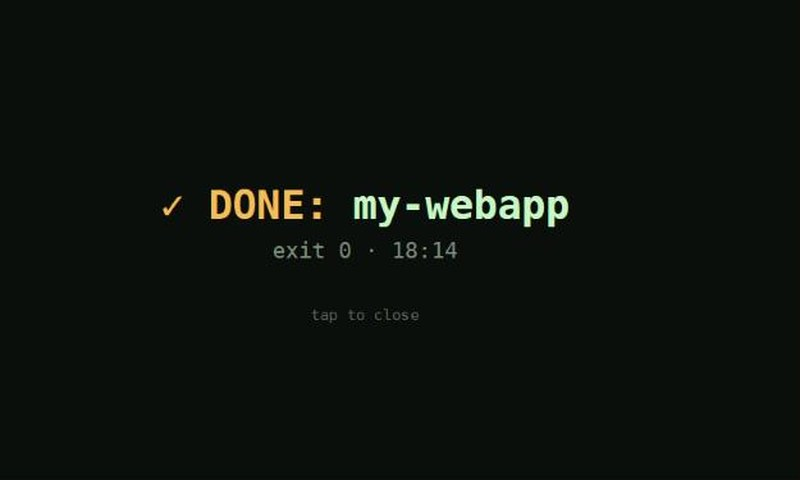

# Pi Status per DeskThing

🇬🇧 [Read in English](README.md)

Un'app [DeskThing](https://deskthing.app) per lo Spotify **Car Thing** che mostra cosa stanno
facendo le istanze del [coding agent Pi](https://pi.dev), con una piccola mascotte in pixel art
("Robottina") che corre mentre Pi lavora.

| Al lavoro | Pi ti chiede qualcosa | Lavoro finito |
|---|---|---|
|  |  |  |

*Screenshot alla risoluzione del Car Thing (800×480), con dati di esempio, in inglese (lingua predefinita).*

- **Stato in tempo reale di ogni istanza di Pi**: al lavoro, libera, finita da N minuti.
- **"Pi ti sta chiedendo qualcosa"**: quando Pi si ferma per farti una domanda (lo strumento
  `ask_user` di [pi-ask](https://www.npmjs.com/package/@eko24ive/pi-ask), la skill *grilling*, o una
  risposta che si chiude con una domanda) lo schermo va in **glitch**.
- **Avviso "✓ DONE"** quando un lavoro finisce.
- **Spegnimento dello schermo** del Car Thing: si spegne dopo N minuti senza tocchi, rotella o tasti
  e si riaccende da solo quando Pi inizia/finisce/chiede, o quando parte la musica.
- **Allarmi degli stack**: se l'app compagna [Stack Status](https://github.com/franzo-ux/deskthing-stack-status)
  segnala un servizio giù, Pi Status mostra l'avviso e passa il Car Thing a quell'app.
- **Italiano o inglese**: la lingua si sceglie nelle impostazioni (predefinita: inglese).

```
 ┌────────── VM / server con Pi ──────────────┐        ┌──────── PC con DeskThing ───────────┐
 │ pi + estensione deskthing-status.ts        │        │ app Pi Status (server)              │
 │   scrive ~/.pi/agent/deskthing-status/*.json│ HTTP  │   interroga la VM ogni 2 s          │ USB/ADB ┌───────────┐
 │ pi-status-server.py  (porta 8765) ─────────┼──────▶ │   schermo, musica, allarmi ─────────┼────────▶│ Car Thing │
 └────────────────────────────────────────────┘        └─────────────────────────────────────┘         └───────────┘
```

## Requisiti

- Un Car Thing con il firmware per DeskThing, collegato via USB a un PC con **DeskThing ≥ 0.11**.
- **Node.js ≥ 20** sul PC (serve solo per compilare l'app).
- Sulla macchina con Pi: **Pi ≥ 1.1**, **Python 3** e (per il servizio) **systemd**.

## 1. Macchina con Pi

```bash
# l'estensione di Pi: ogni istanza segnala al lavoro / libera / ti chiede
cp vm/deskthing-status.ts ~/.pi/agent/extensions/

# il servizio di stato (Python puro, nessuna dipendenza)
mkdir -p ~/scripts ~/.config/systemd/user
cp vm/pi-status-server.py ~/scripts/
cp vm/pi-status.service ~/.config/systemd/user/
systemctl --user daemon-reload
systemctl --user enable --now pi-status.service
loginctl enable-linger "$USER"   # resta attivo anche quando esci dalla sessione

curl http://localhost:8765/status   # → {"busy": 0, "sessions": [...]}
```

Le istanze di Pi già aperte caricano l'estensione dopo `/reload`, quelle nuove da sole.
La porta si cambia con la variabile `PI_STATUS_PORT` nel file del servizio.
Controlla che il PC raggiunga `http://<macchina>:8765/status` (firewall).

## 2. Compilare e installare l'app DeskThing

```bash
npm install
npm run build          # → dist/pistatus
# chiudi DeskThing (icona vicino all'orologio → Esci), poi:
npm run deploy         # copia l'app in DeskThing e la registra
```

Riapri DeskThing e apri **Pi Status** sul Car Thing.
Per aggiornare un'app già installata: `npm run build`, poi `npm run deploy -- --files` e riavvia DeskThing.

> Perché non "carica zip"? DeskThing 0.11 non ha un caricamento locale affidabile nell'interfaccia,
> quindi `deploy` copia l'app in `%APPDATA%\deskthing\apps\pistatus` (Windows;
> `~/Library/Application Support/deskthing` su macOS, `~/.config/deskthing` su Linux, oppure imposta
> `DESKTHING_DIR`) e la aggiunge ad `apps.json`.

## 3. Impostazioni (DeskThing → App → Pi Status)

| Impostazione | Significato |
|---|---|
| Language / Lingua | **English** (predefinita) o **Italiano**: lo schermo cambia subito, le voci delle impostazioni dopo il riavvio di DeskThing |
| Indirizzo stato Pi | URL del servizio di stato, es. `http://pi-host.local:8765/status` |
| Spegni schermo dopo (minuti) | spegnimento dello schermo del Car Thing; `0` = mai |
| Passa a Stack Status sugli allarmi | passa a Stack Status quando segnala un servizio giù |
| Mascotte | la mascotte sullo schermo |

## Come funziona

- **Estensione di Pi** (`vm/deskthing-status.ts`): ascolta `agent_start`, `tool_execution_start/end`
  (domande) e `agent_settled`; scrive un piccolo file JSON per ogni processo di Pi.
- **Servizio di stato** (`vm/pi-status-server.py`): pubblica quei file in JSON ed elimina quelli
  dei processi che non esistono più.
- **Spegnimento schermo** (`app/server/screen-idle.sh`): viene copiato sul Car Thing via ADB in `/var`
  (il resto del sistema è in sola lettura) e avviato dall'app; osserva tasti, rotella e tocchi e
  spegne/accende la retroilluminazione. L'app lo ricontrolla ogni minuto, quindi sopravvive ai riavvii.
- L'orologio del Car Thing non è sincronizzato: tutti gli orari mostrati arrivano dal PC.

## Problemi comuni

- **Rotella e tasti smettono di funzionare**: un'app aveva preso il focus della tastiera. Queste app
  non lo prendono mai al tocco; se succede con altre app riavvia il client di DeskThing.
- **Le icone non cambiano dopo un aggiornamento**: DeskThing fa tenere in memoria le icone per 24 ore.
- **"host di Pi non raggiungibile"**: controlla l'URL nelle impostazioni e che la porta 8765 sia raggiungibile.

## Note

- DeskThing 0.11 consegna i messaggi `sendToApp` al mittente invece che al destinatario, quindi
  Stack Status passa gli allarmi tramite un file (`apps/homelab/alert.json`) che Pi Status controlla.
- La mascotte di questo repository (Robottina) è pixel art originale.

## Licenza

[MIT](LICENSE): puoi usarlo, modificarlo e condividerlo liberamente.
